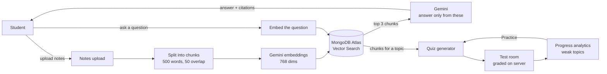

# StudyMate AI

**An AI study partner that only answers from *your* notes.**

Upload your lecture notes (PDF, Word, PowerPoint, images or text). StudyMate AI reads them, answers your questions with citations to the exact page, generates quizzes from them, grades your attempts and tells you which topics you are weak in.

Built with the **MERN** stack (MongoDB, Express, React, Node.js) and **Google Gemini**, using **RAG** (Retrieval-Augmented Generation), so the AI doesn't make things up.

> B.Tech Semester 7 project.

---

## Table of contents
- [Why StudyMate AI?](#why-studymate-ai)
- [Features (9 modules)](#features-9-modules)
- [How it works](#how-it-works)
- [Tech stack](#tech-stack)
- [Project structure](#project-structure)
- [Getting started](#getting-started)
- [Environment variables](#environment-variables)
- [Optional: LiteLLM proxy with Docker](#optional-litellm-proxy-with-docker)
- [Optional: payments with Razorpay](#optional-payments-with-razorpay)
- [Testing](#testing)
- [Troubleshooting](#troubleshooting)
- [Production build](#production-build)

---

## Why StudyMate AI?

General chatbots answer from the whole internet. They can be wrong, they don't match your syllabus, and you can't check where an answer came from.

StudyMate AI is different:

| Problem | StudyMate AI's answer |
|---|---|
| AI makes up facts | Answers come **only from your uploaded notes**; if it's not there, it says *"I don't have that in your notes."* |
| Can't verify answers | Every fact has a **`[Source n]` citation** you can click to see the note title and page number |
| Passive reading doesn't stick | **Auto-generated quizzes** from your own notes, with step-by-step explanations |
| You don't know what to revise | **Progress analytics** flag weak topics and link straight to practice |

---

## Features (9 modules)

### 1. Accounts & authentication
- Sign up / log in with email + password (hashed with **bcrypt**) or **Continue with Google**.
- Login session stored in a secure **httpOnly JWT cookie**.
- **Forgot password** via a one-time reset link (valid 30 minutes); a reset logs out all other devices.
- Brute-force protection: max 10 login attempts per IP every 15 minutes.
- Every new user gets **10,000 free tokens**.

### 2. Notes upload
- Upload **PDF, DOCX, PPTX, TXT, MD, PNG, JPG, WEBP** (up to 10 MB), or paste text.
- **Scanned PDFs and photos of notes** are read by Gemini (OCR).
- Notes are grouped by subject, with page/slide count and a preview excerpt.

### 3. Note splitter & AI indexer
- Notes are split into **500-word chunks with 50-word overlap**, each remembering which pages it came from.
- Each chunk is turned into a **768-dimension embedding** (`gemini-embedding-001`) and stored in **MongoDB Atlas Vector Search**.

### 4. AI tutor (RAG chat)
- Ask a question → the 3 most relevant chunks are retrieved → Gemini answers **only from them**, with citations.
- Understands follow-ups ("explain simpler") using recent chat history.
- Click a citation to see the source text, note title and pages.
- No matching notes → fixed reply, **0 tokens charged**.

### 5. Token wallet
- Every AI action is charged by the tokens it actually uses (prompt tokens at ¼ rate, answer tokens at full rate).
- Wallet page: live balance, 30-day usage, and a full activity ledger.
- Out of tokens → a banner on every page with a link to recharge.

### 6. Quiz generator
- Choose a **topic**, a **source** (one of your subjects, or *General knowledge*), **5/10/15 questions** and **Easy/Medium/Hard**.
- Gemini returns MCQs in JSON; the server **validates** every question (4 distinct options, a valid answer, an explanation) and **shuffles options** so the answer isn't always A or B.
- Correct answers are **never sent to the browser** before you submit.

### 7. Test room
- Clean A–D option cards, a sticky progress bar with a timer, and a warning for unanswered questions.
- **Graded on the server** (can't be cheated from the browser).
- Results: score, time, pass/fail, correct/wrong marking, step-by-step explanations, a *Mistakes only* filter, **Retake** and **New quiz on this topic**.

### 8. Progress analytics
- Stat tiles, accuracy trend chart (with a 70% target line), and accuracy by difficulty.
- Per-topic table: average, last-3 average, change since your first attempt.
- **Weak topic = last 3 attempts average below 70%.** Each weak topic gets a **Practice →** button that pre-fills a new quiz.

### 9. Billing (recharge)
- **Token pack** (one-time) and **Pro** (one month of tokens) via **Razorpay Checkout**.
- Pay by **card, UPI ID / UPI app, or UPI QR code**.
- The server verifies Razorpay's **HMAC signature** before adding tokens, and each order can add tokens only once.

**Also included:** a public landing page, light/dark theme toggle, a mobile-friendly layout (tested at 375 px), and reduced-motion support.

---

## How it works



**RAG in one line:** instead of asking the AI "what do you know?", we ask "here are the relevant parts of the student's notes — answer using only these".

---

## Tech stack

| Layer | Technology |
|---|---|
| Frontend | React 19, React Router 7, Vite 7 (plain CSS, no UI library) |
| Backend | Node.js 22, Express 5 |
| Database | MongoDB Atlas (+ Atlas Vector Search) |
| AI | Google Gemini (`gemini-3.5-flash` for text, `gemini-embedding-001` for embeddings) |
| AI proxy (optional) | LiteLLM in Docker — API-key pooling and retries |
| Auth | bcrypt, JWT (httpOnly cookie), Google Identity Services |
| File parsing | pdf-parse, built-in DOCX/PPTX reader, Gemini OCR for images & scans |
| Payments | Razorpay Checkout (card, UPI, UPI QR) |
| Email | Nodemailer (password reset) |
| Testing | Node self-check (`check.js`), Playwright end-to-end |

---

## Project structure

```
StudyMateAI/
├── client/                 React frontend (Vite)
│   ├── index.html          global styles, theme, Google & Razorpay scripts
│   ├── e2e/                Playwright tests
│   └── src/
│       ├── App.jsx         routing, nav, API helper, shared helpers
│       └── pages/
│           ├── Landing.jsx     public home page
│           ├── Login.jsx       login / signup / forgot / reset password
│           ├── Notes.jsx       Module 2 – upload & manage notes
│           ├── Chat.jsx        Module 4 – AI tutor
│           ├── Quiz.jsx        Modules 6 & 7 – quiz generator & test room
│           ├── Dashboard.jsx   Module 8 – progress analytics
│           └── Wallet.jsx      Modules 5 & 9 – wallet & recharge
├── server/                 Express backend
│   ├── index.js            all API routes (auth, notes, chat, quiz, stats, wallet)
│   ├── ai.js               chunking, embeddings, Gemini calls, grading, analytics, token cost
│   ├── extract.js          DOCX / PPTX text extraction
│   ├── billing.js          Razorpay orders + signature check (and legacy Stripe webhook)
│   ├── check.js            self-check tests (no DB or API key needed)
│   └── demo.js             demo mode with local MongoDB
├── litellm/                optional Docker LiteLLM proxy
├── start.bat               one-click start on Windows
└── DEVLOG.md               detailed log of what was built and how it was tested
```

---

## Getting started

### Prerequisites
- **Node.js 20+** (developed on Node 22)
- A **MongoDB Atlas** account (free M0 cluster is enough)
- A **Gemini API key** from https://aistudio.google.com/apikey

### 1. Clone and configure
```bash
git clone https://github.com/Study-Mate-AI/StudyMate-AI.git
cd StudyMate-AI
cp server/.env.example server/.env
cp client/.env.example client/.env
```
Fill in at least `MONGODB_URI`, `JWT_SECRET` and `GEMINI_API_KEY` in `server/.env` (see [Environment variables](#environment-variables)).
The Atlas vector index is created automatically the first time the server starts.

### 2. Run

**Windows (easiest):** double-click **`start.bat`**. It installs packages on first run, starts LiteLLM in Docker if configured, opens the API and website in two windows, and opens http://localhost:5173.

**Any OS:** run these in two terminals:
```bash
cd server && npm install && npm start
```
```bash
cd client && npm install && npm run dev
```
Open **http://localhost:5173** once the server prints `StudyMate API on :3000`.

> Use `npm start` for demos. `npm run dev` on the server restarts on file changes, which can interrupt a request mid-way on some Windows PCs.

### Quick demo without Atlas
Uses a local MongoDB (`mongodb://127.0.0.1:27017`). Login, notes, *General knowledge* quizzes, the test room and progress all work; the tutor and notes-based quizzes need Atlas Vector Search.
```powershell
cd server
$env:GEMINI_API_KEY="your-key"; npm run demo
```

---

## Environment variables

### `server/.env`
| Variable | Required | Description |
|---|---|---|
| `MONGODB_URI` | ✅ | MongoDB Atlas connection string |
| `JWT_SECRET` | ✅ | Any long random string, used to sign login cookies |
| `GEMINI_API_KEY` | ✅ | One key, or several comma-separated keys (from different Google projects) for higher rate limits |
| `GEMINI_MODEL` | | Defaults to `gemini-3.5-flash` |
| `GOOGLE_CLIENT_ID` | | For *Continue with Google* (OAuth **Web** client, origins `http://localhost` and `http://localhost:5173`) |
| `RAZORPAY_KEY_ID`, `RAZORPAY_KEY_SECRET` | | For recharging tokens |
| `PACK_PRICE_INR`, `PRO_PRICE_INR` | | Prices in rupees (default 399 / 749) |
| `PACK_CREDITS`, `PRO_CREDITS` | | Tokens granted (default 50,000 / 200,000) |
| `SMTP_URL`, `MAIL_FROM`, `APP_URL` | | Password-reset email; without `SMTP_URL` the link is printed in the server console |
| `LITELLM_URL`, `LITELLM_KEY` | | Route Gemini through the Docker proxy (see below) |

### `client/.env`
| Variable | Description |
|---|---|
| `VITE_GOOGLE_CLIENT_ID` | Same Client ID as `GOOGLE_CLIENT_ID` |

> `.env` files are git-ignored. Only the `.env.example` templates are committed, so never put real keys in them.

---

## Optional: LiteLLM proxy with Docker

LiteLLM sits between the server and Gemini. It spreads requests across several API keys and retries failed calls.

```
Express server  →  LiteLLM (localhost:4000, Docker)  →  Gemini
```

1. Install and start **Docker Desktop**.
2. `cp litellm/.env.example litellm/.env`, then set `GEMINI_KEY_1` and `LITELLM_MASTER_KEY` (any `sk-...` string). For more keys, add `GEMINI_KEY_2`, … and copy the two model entries in `litellm/config.yaml`.
3. Start it:
   ```bash
   cd litellm
   docker compose up -d
   ```
4. Add to `server/.env` and restart the server:
   ```
   LITELLM_URL=http://localhost:4000
   LITELLM_KEY=<same as LITELLM_MASTER_KEY>
   ```

Stop it with `docker compose down`. Remove the two `LITELLM_*` lines to call Gemini directly again.

---

## Optional: payments with Razorpay

1. Create an account at https://dashboard.razorpay.com and switch to **Test Mode**.
2. **Account & Settings → API keys** → generate a key pair, then put it in `server/.env` as `RAZORPAY_KEY_ID` and `RAZORPAY_KEY_SECRET`.
3. **Checkout settings → Payment Configuration** → make sure **Cards** and **UPI** are enabled. If UPI is unavailable, ask Razorpay support to enable it for test mode.
4. Restart the server and open **Wallet → Buy tokens**.
5. Test with UPI ID `success@razorpay` or a Razorpay test card.

**How it's secured:** the server creates the order, so the price can't be changed in the browser. After payment it checks Razorpay's HMAC-SHA256 signature, and each order can add tokens only once.

---

## Testing

```bash
cd server && npm run check
```
Tests chunking (with page ranges), citation parsing, grading, quiz cleanup and shuffling, progress analytics, Gemini key rotation and the Razorpay signature check. It needs no database or API key.

```bash
cd client && npx playwright test
```
End-to-end UI tests. The client dev server must be running.

---

## Troubleshooting

| Error | Fix |
|---|---|
| `SSL alert number 80` | Atlas is blocking your IP. Add `0.0.0.0/0` under **Atlas → Security → Network Access** and wait for it to show *Active*. |
| `querySrv ECONNREFUSED` | Your DNS can't resolve `mongodb+srv://`. Use Atlas's standard `mongodb://host1,host2,host3/?ssl=true&replicaSet=...&authSource=admin` string. |
| "The AI is busy right now" | Gemini's free tier is rate-limited. Wait a minute, or add more keys to `GEMINI_API_KEY`. |
| "The AI service is offline" | `LITELLM_URL` is set but Docker isn't running. Start Docker Desktop, or remove the `LITELLM_*` lines. |
| Google sign-in `origin_mismatch` | The client must run on port **5173**; add `http://localhost:5173` to the OAuth client's origins. |
| Only *Cards* shows in Razorpay | UPI isn't enabled on your Razorpay account. See [payments](#optional-payments-with-razorpay), step 3. |

---

## Production build

```bash
cd client && npm run build
cd ../server && npm start
```
The server then serves both the API and the built website on **http://localhost:3000**.
